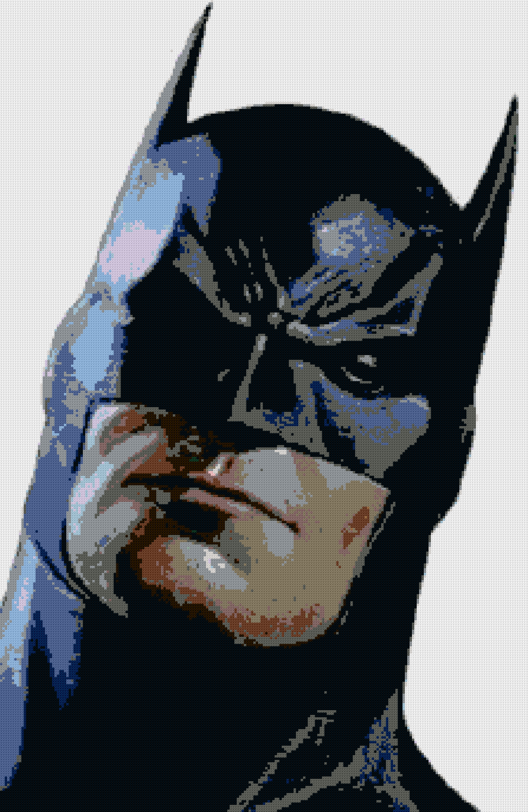
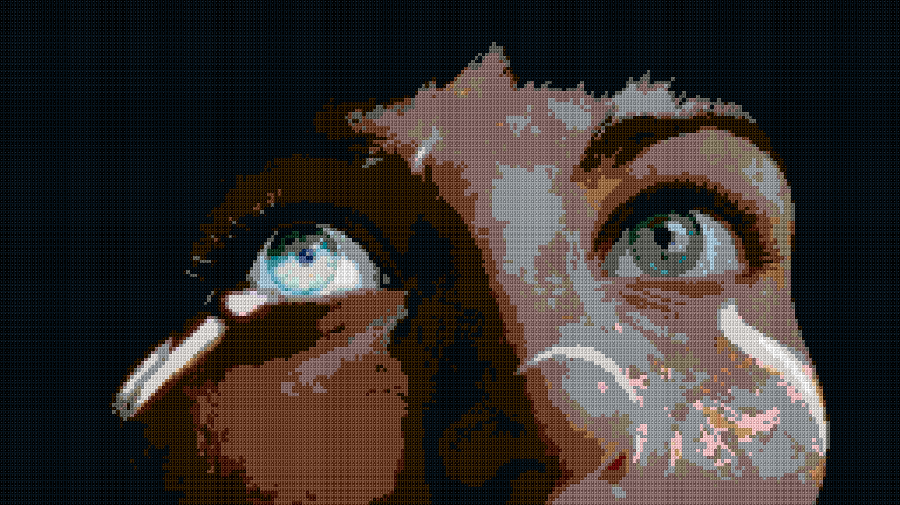
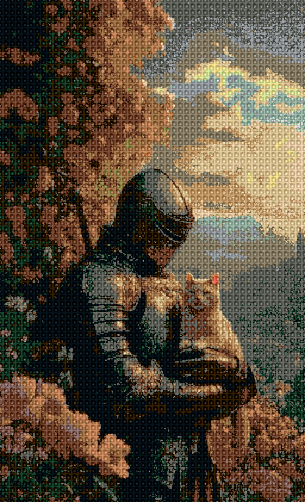
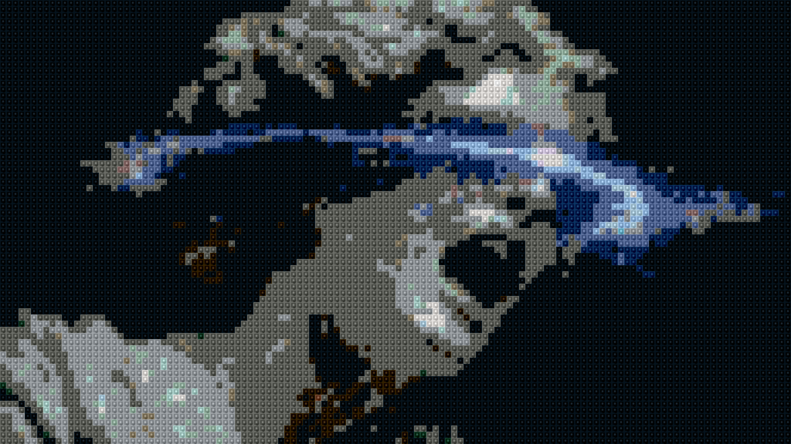
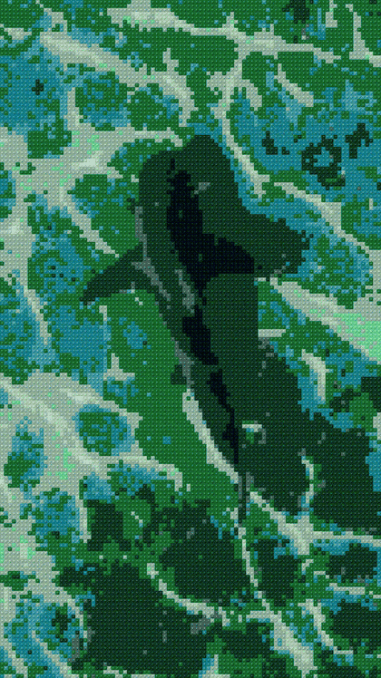
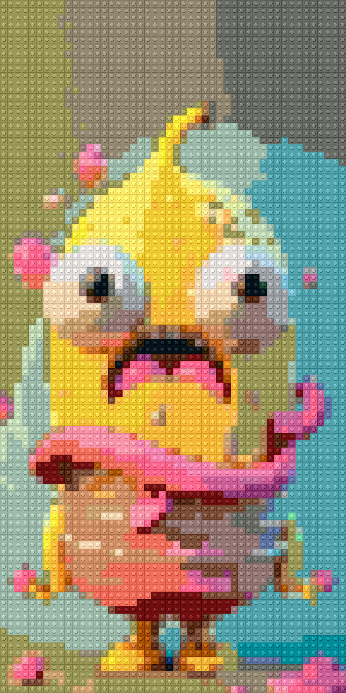

  

  Turn photos, animations, and videos into mosaics

Forma maps visual detail onto distinct plastic bricks, using authentic LEGO color palettes, stud highlights, and subtle shadow contours. It works on still photos, animations, and full videos.

## Gallery

  <table>
     <tr>
       <td align="center"></td>
       <td align="center"></td>
       <td align="center"></td>
     </tr>
     <tr>
       <td align="center"></td>
       <td></td>
       <td></td>
     </tr>
     <tr>
      <td></td>
     </tr>
   </table>

---

Try yourself: https://forma.kaushik-gupta.com/
